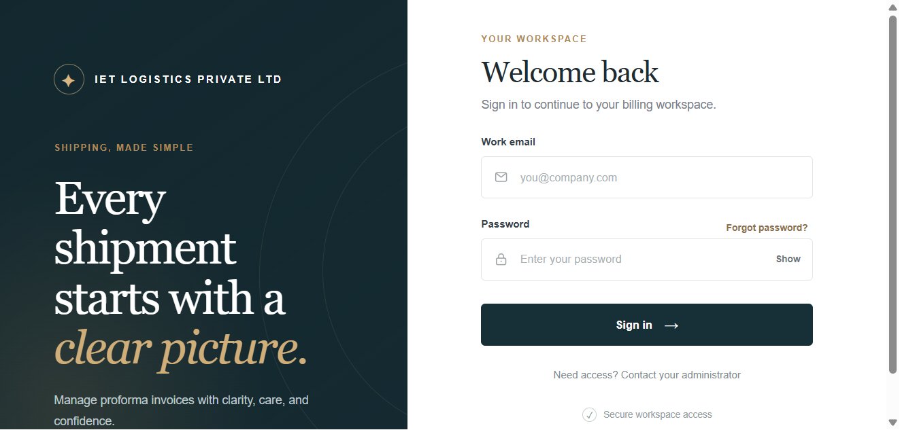
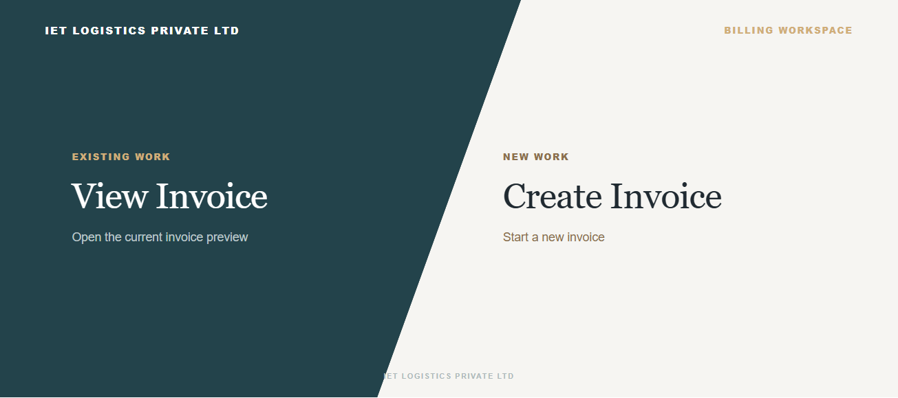
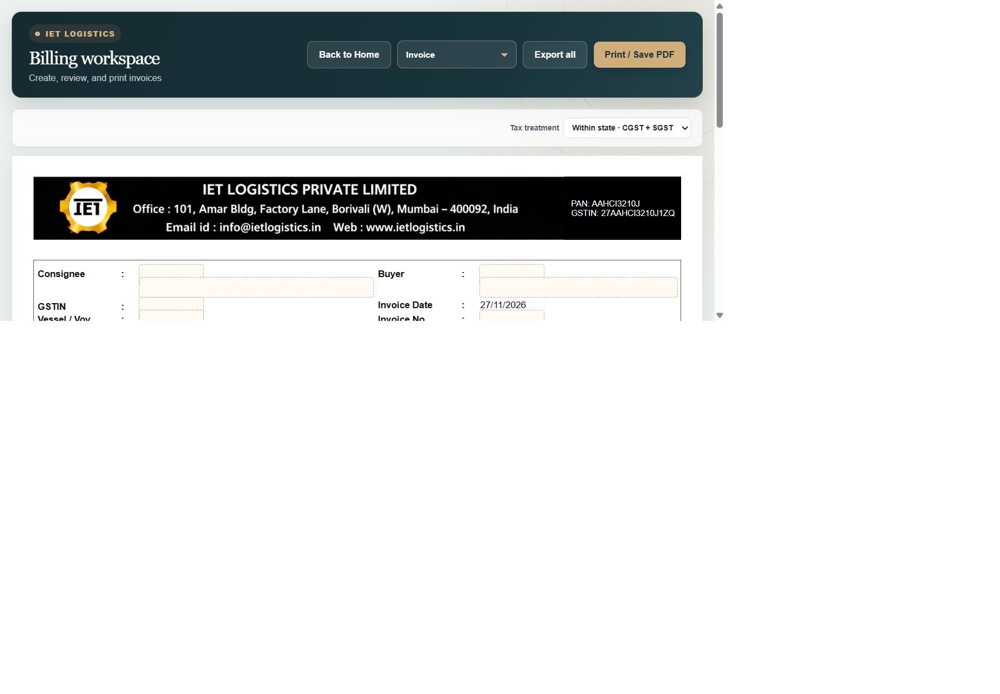

# IET Billing System

Billing workspace for creating, reviewing, and printing proforma invoices.

## Download and install on Windows

The Windows installer is generated at:

```text
release/squirrel-installer/IET Billing System Setup 1.0.0.exe
```

To install it on another Windows device:

1. Copy or download the Setup `.exe` to that device.
2. Double-click **IET Billing System Setup 1.0.0.exe** and allow setup to finish.
3. Open **IET Billing System** from the Start menu.
4. On first launch, enter the hosted MongoDB connection details if prompted.

The app needs internet access to connect to its hosted database. This build is unsigned, so Windows Smart App Control may block it. For distribution, use a build signed with a trusted code-signing certificate or ask your IT administrator to approve it; do not disable Windows security.

To build the installer from source on Windows, install the project dependencies and run:

```powershell
npm ci
npm --prefix frontend ci
npm run build:win
```

The generated installer is written to `release/squirrel-installer`.

## Screenshots

### Sign in



### Billing home



### Invoice workspace



## Host the frontend and backend on Vercel

Create two Vercel projects from this repository:

1. **Backend project:** set the root directory to `backend`. Add these environment variables in the Vercel dashboard:
   - `NODE_ENV=production`
   - `MONGODB_URI` — production MongoDB connection string
   - `ADMIN_EMAIL` — initial administrator email
   - `ADMIN_PASSWORD_HASH` — bcrypt hash, not the plain password
   - `JWT_SECRET` — random secret of at least 32 characters
   - `FRONTEND_ORIGIN` — exact frontend URL, for example `https://your-frontend.vercel.app`
   - `TRUST_PROXY=true`
2. **Frontend project:** set the root directory to `frontend`, use the Vite preset, build command `npm run build`, and output directory `dist`.
3. Add `VITE_API_URL` to the frontend project's environment variables, set to the backend URL (for example `https://your-api.vercel.app`), then deploy.
4. Set `FRONTEND_ORIGIN` to the deployed frontend's exact URL in the backend project and redeploy it.
5. Configure MongoDB Atlas network access for the backend deployment.

Keep all database credentials and secrets in Vercel's environment settings; do not commit them to this repository. Changing `VITE_API_URL` requires a new frontend deployment. More backend details are in [backend/README.md](backend/README.md).
